<p align="center">
  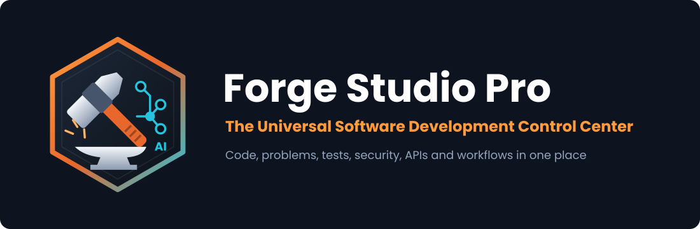
</p>

# Forge Studio Pro

**The Universal Software Development Control Center for Visual Studio Code.**

Forge Studio Pro is not just a coding assistant. It is one workspace that connects your code, problems, tests, debugging, security, APIs, workflows and deployments, so you can see what is happening in a project and act on it without jumping between separate tools.

Author: [radwanalmsora](https://github.com/radwanalmsora)

---

## Contents

- [Why Forge Studio Pro](#why-forge-studio-pro)
- [The Project Universe](#the-project-universe)
- [The eight systems](#the-eight-systems)
- [Installation](#installation)
- [Build the VSIX with GitHub Actions](#build-the-vsix-with-github-actions)
- [Quick start](#quick-start)
- [Commands](#commands)
- [Settings](#settings)
- [Security and privacy of the extension](#security-and-privacy-of-the-extension)
- [Scope and limitations](#scope-and-limitations)
- [Development](#development)

## Why Forge Studio Pro

A developer constantly moves between Git, the terminal, the debugger, test runners, security scanners, API clients, database tools, dependency managers and deployment scripts. Each tool shows one slice. Forge links the slices:

| Question | Where Forge answers it |
|---|---|
| Is the project healthy right now? | Command Center |
| What is broken, and what else does it affect? | Problem Solver |
| Which files do I touch to change this feature? | Project Understanding |
| Can these checks run automatically? | Workflow Automation |
| Which tests matter for my change? | Testing Universe |
| Why did this fail? | Debugging Universe |
| Where are the risks? | Security and Privacy Center |
| Who calls this endpoint? | API Studio |

## The Project Universe

When you open a project, Forge builds a local index of files, symbols, imports, API routes, HTTP calls, database schemas and tests. All eight systems read from that same model and update when files change.

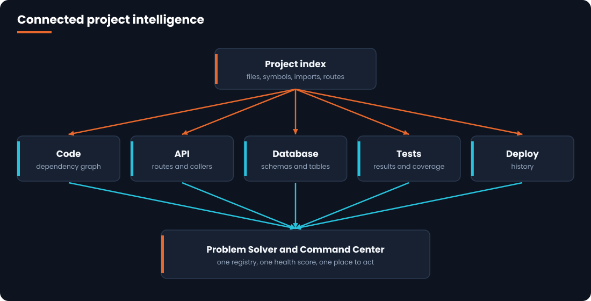

```text
CODE ───── API ───── DATABASE ───── TESTS ───── DEPLOYMENT
 │          │            │            │             │
PROBLEMS  CALLERS      TABLES      COVERAGE      HISTORY
 └──────────┴────────────┴────────────┴─────────────┘
                 CONNECTED INTELLIGENCE
```

> The screenshots below are rendered from the extension's own interface using a small sample project. Colors follow your VS Code theme.

---

## The eight systems

### 1. Project Command Center

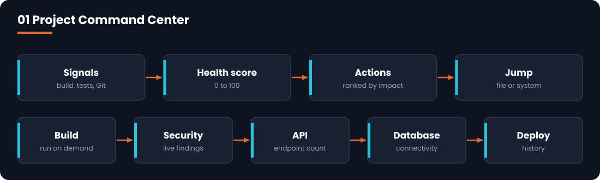

The main dashboard. It shows the real state of the project; every value comes from a scan or from a command you ran.

| Row | What it shows | Action |
|---|---|---|
| Build | Last build result and duration | Run build |
| Tests | Pass or fail, with the failure count | Run tests |
| Security | High-risk and lower-risk findings | Review |
| Dependencies | Vulnerable and outdated npm packages | Check |
| Git | Changed files and current branch | Commit with checks |
| API | Endpoints detected in source code | Open API Studio |
| Database | Drivers, tables and connectivity | Test connection |
| Deployment | Result of the last deployment | Deploy |

**Health score (0 to 100).** The score starts at 100 and subtracts capped penalties for open problems (weighted by severity), failing tests, a failing build, vulnerable or outdated dependencies and unfinished markers (`TODO`, `FIXME`, not-implemented errors). A row that has not been checked does not lower the score.

**Action required** is a ranked to-do list. Selecting an item opens the relevant system. The **Project universe** strip and **Deployment history** (with command output) complete the view. The score also appears in the status bar.

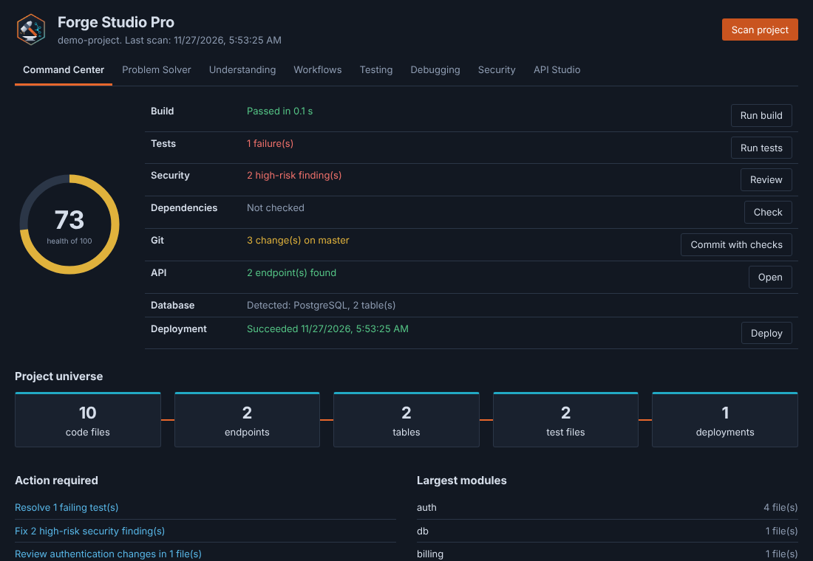

---

### 2. Universal Problem Solver

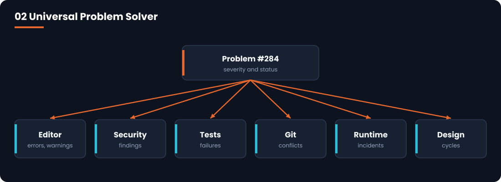

Every issue becomes a numbered entity in one registry.

| Source | Problem type |
|---|---|
| VS Code diagnostics (any language extension) | Compilation Error, Bug, Dependency Conflict, Configuration, Database, UI, Compatibility, Performance or Memory Problem |
| Security scanner and npm audit | Security Vulnerability |
| Test runs | Test Failure |
| Build command | Compilation Error |
| Git | Git Conflict |
| Debugger and failed tasks | Runtime Error, Environment Issue |
| Deploy command | Deployment Failure |
| Import graph | Architecture Problem (circular dependency) |

Types for editor diagnostics are assigned from the message text.

- **Stable numbers.** A problem keeps its number between scans and restarts.
- **Lifecycle.** `Open`, `Investigating` and `Ignored` are set by you. `Resolved` is set automatically when the problem is no longer detected.
- **Analyze.** Shows the location, affected systems, the problem graph (which files depend on the broken one) and related tests.

```text
userRepository.js          <- problem
└── authService.js
    └── authController.js
        └── server.js
```

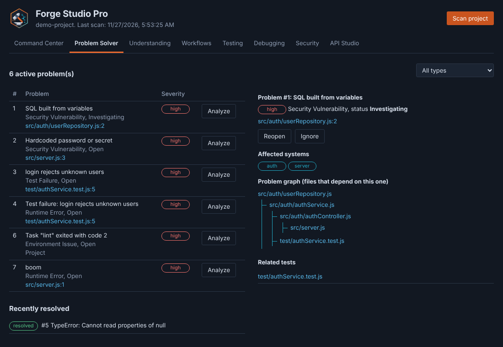

---

### 3. Deep Project Understanding

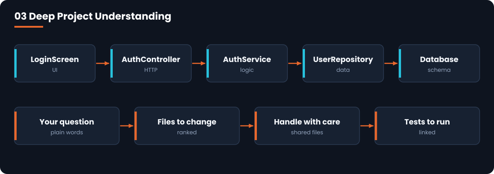

Goes beyond text search by combining symbols, imports and routes into a dependency graph.

- **Ask what you want to change**, for example `change how login works`. Forge ranks files by paths, symbol names, routes and related terms (login, auth, session, token), then shows:
  - a **system map** from the best entry point,
  - the **files likely to change**,
  - **shared files to handle with care** (dependencies used by several files),
  - the **tests to run afterwards**.
- **File impact analysis** (also in the editor context menu): dependents, dependencies, affected systems, endpoints, data layer, tests and symbols.
- **Architecture warnings:** circular dependencies.

Import resolution covers JavaScript and TypeScript (including `@/` and `~/` aliases), Vue and Svelte, Python, Java and Kotlin, Go modules, PHP, Ruby `require_relative` and Rust `mod`. C#, SQL and Prisma files contribute symbols.

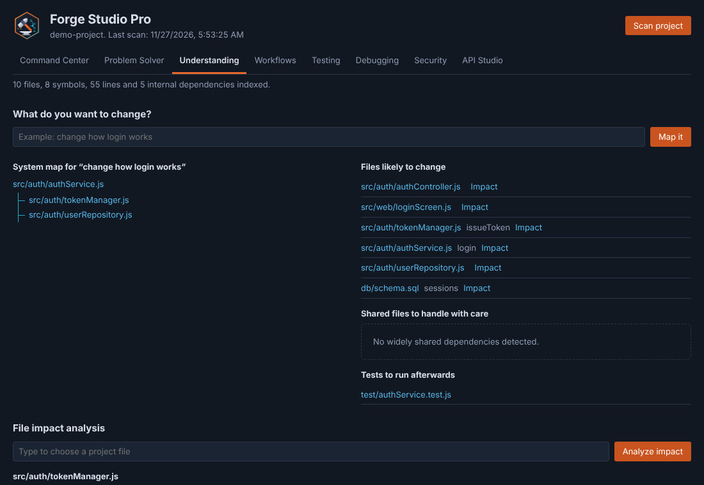

---

### 4. Workflow Automation Engine

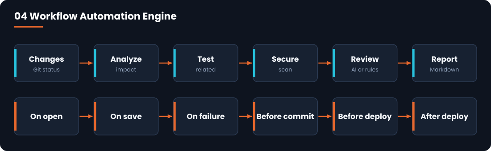

Turn analysis into execution with a **visual editor**: create workflows, add, reorder and remove steps, choose a trigger, and watch each step report its result and output.

**Steps**

| Step | Behavior |
|---|---|
| Analyze changes | Lists Git changes, affected systems and related tests; fails on conflicts |
| Check editor errors | Fails when VS Code reports errors |
| Run build | Runs the detected or configured build |
| Run all tests / related tests | Runs the test command and parses results |
| Security scan | Fails on high or critical findings in changed files (whole project if clean) |
| AI code review | Uses a VS Code language model if available, otherwise local rules |
| Shell command | Runs your command after approval |
| Create incident | Records an incident after a failure |
| Generate report | Produces a Markdown report |

**Triggers:** Manual only, Project opened, File saved (with a file pattern), Task failed, Test failed, Before commit, Before deploy, After deploy.

Five workflows are included: *Before Commit*, *Environment Check*, *Related Files on Save*, *Incident on Test Failure* and *Before Deploy Review*. Saved workflows live in `.forge/workflows.json`, so a team can version them:

```json
{
  "version": 1,
  "workflows": [
    {
      "id": "quality-gate",
      "name": "Quality Gate",
      "trigger": "preCommit",
      "steps": [
        { "type": "command", "command": "npm run lint" },
        { "type": "relatedTests" },
        { "type": "securityScan" },
        { "type": "report" }
      ]
    }
  ]
}
```

*Before commit* workflows run when you use **Forge: Commit with Checks**. They do not intercept commits made from the terminal or the Source Control view.

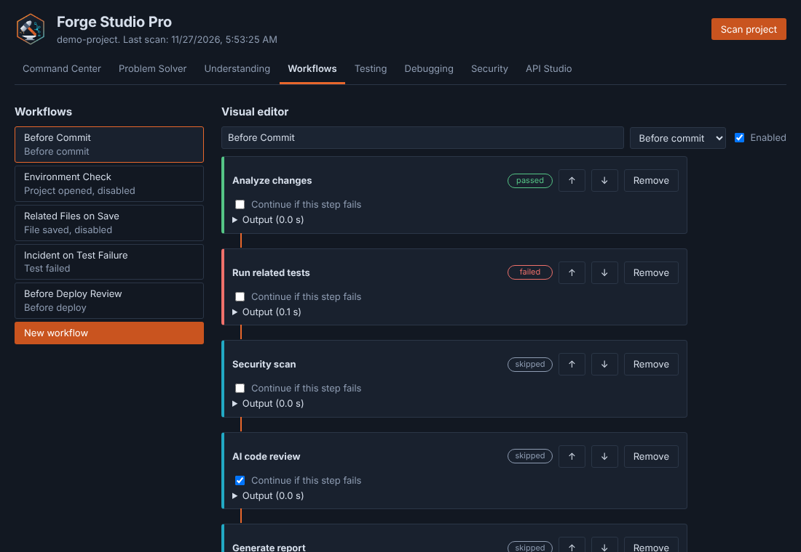

---

### 5. Testing Universe

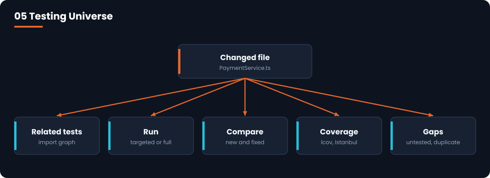

- **Detection:** Jest, Vitest, Mocha, `node:test`, pytest, Go, Cargo, Maven, Gradle and .NET, or your own `forge.testCommand`.
- **Related tests:** found through the import graph and file naming, based on your uncommitted changes or the open file. Targeted runs are available for Jest, Vitest, Mocha, `node:test`, pytest and Go; other tools run the full suite and say so.
- **Results:** passed and failed counts, failing test names linked to source, raw output.
- **Comparison:** previous run, new failures and fixed tests.
- **Coverage:** reads `coverage/lcov.info`, `coverage/coverage-summary.json`, `lcov.info` or `coverage.lcov`, grouped by module with the weakest files.
- **Gaps:** source files that no detected test reaches, and duplicate test names.
- **Test skeletons:** for JavaScript, TypeScript, Python and Go. Existing files are never overwritten. Skeletons contain placeholders for your assertions.
- **Failure analysis:** one click creates an incident from a failing run.

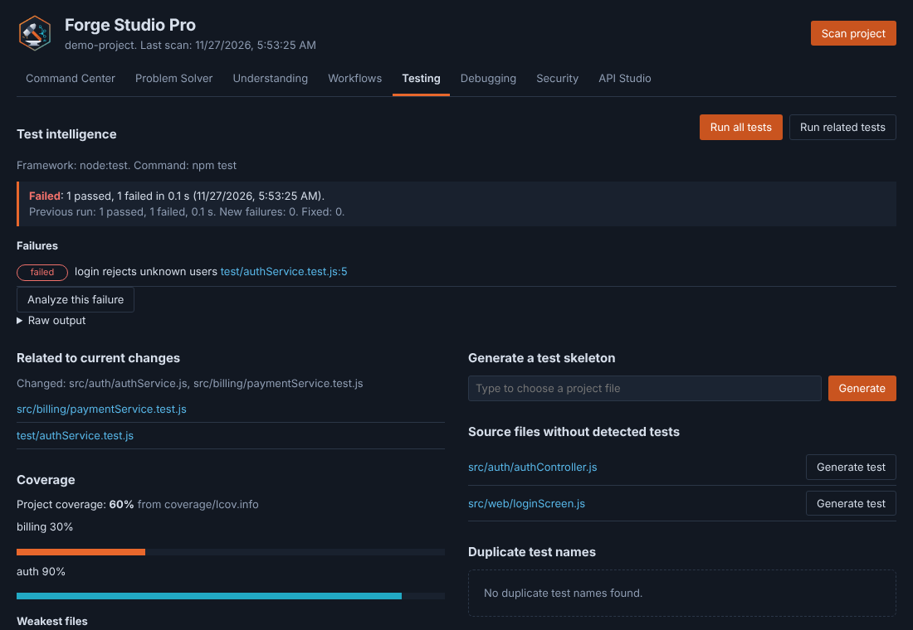

---

### 6. Debugging Universe

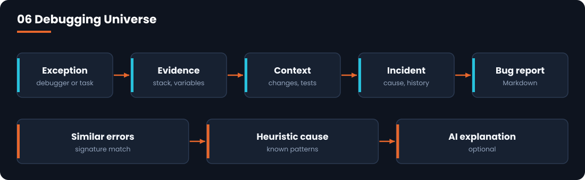

Errors are connected to the rest of the project. Incidents are created from:

1. **Debugger exceptions.** When a debug session stops on an exception, Forge collects the stack trace and up to 20 local variables. Sensitive-looking variable names are hidden.
2. **Failed VS Code tasks.**
3. **Test failures and failed deployments.**
4. **Pasted stack traces** (JavaScript, Python, Java, Kotlin, Go and `file:line` formats), or the selected text in the editor.

Each **incident report** contains the error, a probable cause from known patterns, suggested investigation steps, stack frames linked to files, related tests, uncommitted changes (highlighting files that appear in the stack) and the number of similar earlier incidents. Create a **Markdown bug report** in one click, or request an **AI explanation**.

> Tip: enable *Uncaught Exceptions* (or *Raised Exceptions*) in the VS Code Breakpoints view so the debugger stops and Forge can capture the evidence.

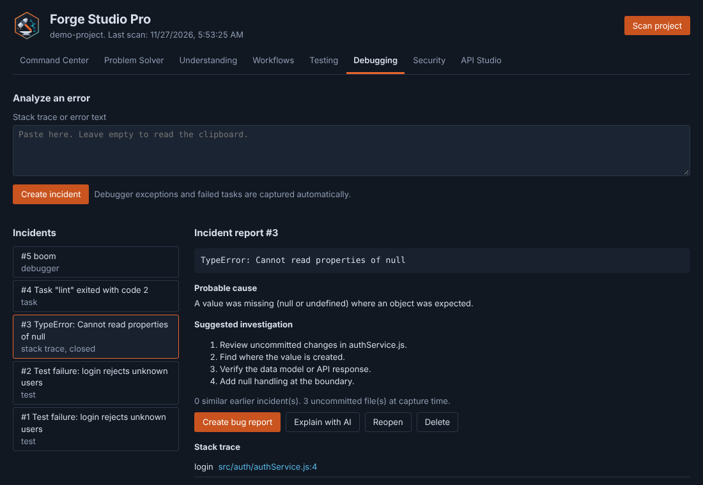

---

### 7. Security and Privacy Center

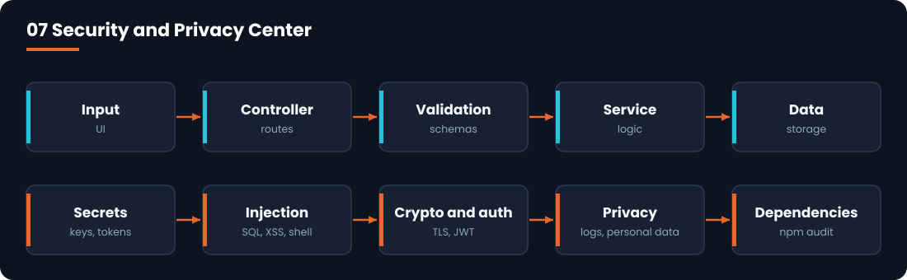

| Category | Examples |
|---|---|
| Secrets | Cloud keys, API tokens, private keys, hardcoded passwords, database URLs with passwords |
| Injection | SQL built from variables, raw HTML assignment, shell commands from variables |
| Unsafe functions | `eval`, dynamic functions, unsafe deserialization |
| Cryptography | MD5 and SHA-1, non-cryptographic random secrets |
| Authentication and authorization | Disabled TLS verification, unsigned JWT, open CORS |
| Privacy | Sensitive values in logs, credentials in browser storage, e-mail addresses and card numbers in files |

- Findings appear in the dashboard **and** in the VS Code Problems panel. Secret values are masked.
- A **quick fix** adds `forge-ignore-next-line` for reviewed findings. A `forge-ignore` comment on a line also works.
- `.env` files ignored by Git are not reported.
- The **security graph** groups files into Input, Controller, Validation, Service and Data layers.
- **Dependency security** runs `npm audit` and `npm outdated` on request.
- **Export** a Markdown security report.

The scanner is pattern based. A clean result is not proof that a project is secure.

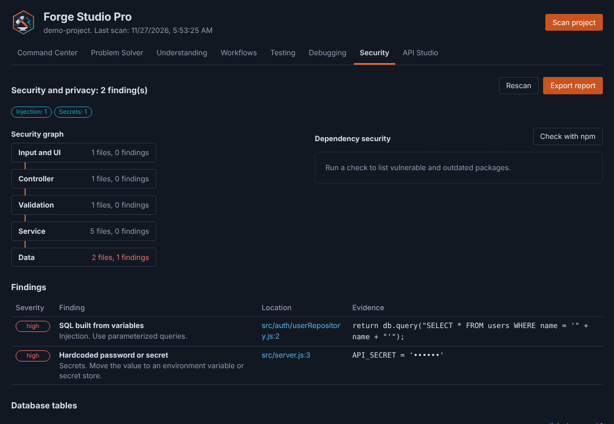

---

### 8. API Studio

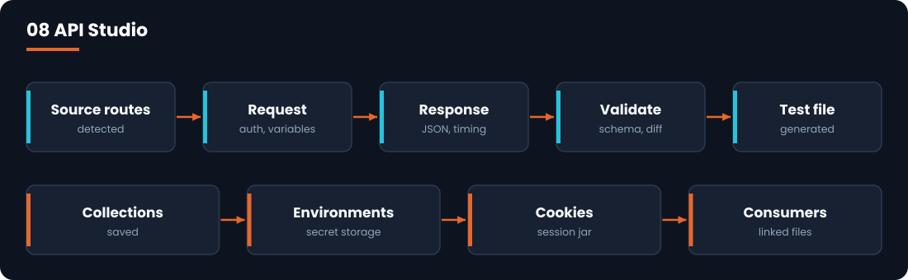

An HTTP workbench connected to your source code.

- **Requests:** GET, POST, PUT, PATCH, DELETE, HEAD and OPTIONS with headers and body.
- **Authentication:** Bearer token or Basic, plus session **cookies**.
- **Environments:** `{{variable}}` substitution, stored in VS Code secret storage.
- **Collections and history:** save, load, export and replay requests.
- **Response viewer:** status, time, size, headers and formatted JSON.
- **Validation:** a JSON Schema subset (`type`, `required`, `properties`, `items`, `enum`, `additionalProperties`, minimum and maximum values and lengths).
- **Comparison:** differences from the previous response of the same request.
- **Test generation:** a `node:test` file that reads credentials from `API_TOKEN` or `API_BASIC_AUTH`.
- **Code links:** routes detected for Express-style routers, NestJS, Next.js, FastAPI, Flask, Django, Spring, Go and Laravel, each with its implementation and its `fetch` or Axios-style consumers.

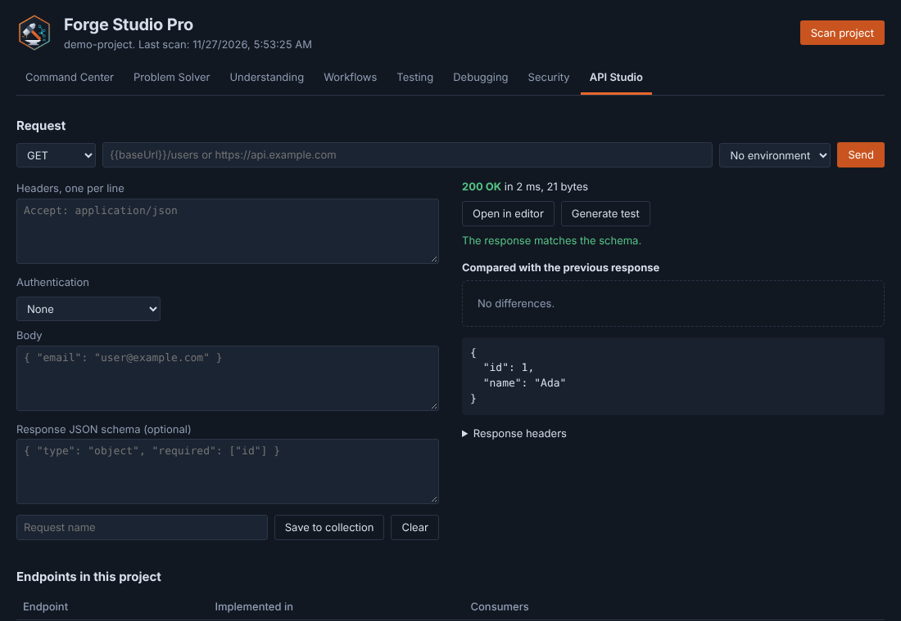

---

## Installation

1. Get `forge-studio-pro.vsix` (see the next section).
2. In VS Code open the **Extensions** view.
3. Choose **...** then **Install from VSIX...** and select the file.

Or from a terminal:

```bash
code --install-extension forge-studio-pro.vsix
```

Requires VS Code 1.90 or newer. Git is recommended.

## Build the VSIX with GitHub Actions

1. Create a GitHub repository, for example `forge-studio-pro`.
2. Upload the **contents** of this folder to the repository root, including the hidden `.github` folder:

   ```bash
   git init
   git add .
   git commit -m "Forge Studio Pro 1.0.0"
   git branch -M main
   git remote add origin https://github.com/radwanalmsora/forge-studio-pro.git
   git push -u origin main
   ```

3. Open the **Actions** tab and wait for **Build VSIX** to finish (you can also start it with **Run workflow**).
4. Download the **forge-studio-pro-vsix** artifact and unzip it to get the `.vsix` file.

Pushing a tag such as `v1.0.0` also attaches the file to a GitHub release:

```bash
git tag v1.0.0
git push origin v1.0.0
```

If you use a different repository name, update the `repository`, `homepage` and `bugs` links in `package.json`. README images load from GitHub, so they are visible inside VS Code when the repository is public.

## Quick start

1. Open a project folder. Forge indexes it automatically.
2. Select the **Forge Studio Pro** icon in the Activity Bar, or press `Ctrl+Alt+Shift+F` (`Cmd+Alt+Shift+F` on macOS).
3. Review **Action required** in the Command Center.
4. Run tests, map a change, then stage your files and use **Forge: Commit with Checks**.

## Commands

| Command | Purpose |
|---|---|
| Forge: Open Studio | Open the control center |
| Forge: Scan Project | Rebuild the project index |
| Forge: Run All Tests | Run the test command |
| Forge: Run Related Tests | Run tests linked to current changes |
| Forge: Run Workflow | Pick and run a workflow |
| Forge: Commit with Checks | Run pre-commit workflows, then commit staged changes |
| Forge: Deploy Project | Run pre-deploy checks, confirm, deploy |
| Forge: Show Impact of This File | Impact analysis for the open file |
| Forge: Generate Test Skeleton | Create a test file for the open file |
| Forge: Analyze Stack Trace | Create an incident from selected or copied text |
| Forge: Export Security Report | Markdown security report |

## Settings

| Setting | Default | Description |
|---|---|---|
| `forge.scanOnStartup` | `true` | Index on startup |
| `forge.exclude` | common build folders | Folder names to skip |
| `forge.maxFiles` | `5000` | Source file limit |
| `forge.testCommand` | detected | Custom test command |
| `forge.buildCommand` | detected | Custom build command |
| `forge.deployCommand` | empty | Deployment command |
| `forge.commandTimeout` | `600` | Command timeout in seconds |
| `forge.workflows.automaticTriggers` | `true` | Allow automatic workflow triggers |
| `forge.ai.enabled` | `true` | Allow optional AI features |
| `forge.api.timeout` | `30` | API request timeout in seconds |

## Security and privacy of the extension

- **No telemetry** and no Forge server. Analysis runs on your machine.
- Network traffic happens only for requests you send in API Studio, a database connection test, `npm audit` and `npm outdated`, your own commands, and the optional AI features.
- **Workspace Trust:** in Restricted Mode Forge analyzes files but does not run Git or project commands.
- **Command approval:** every new build, test, deploy or workflow command is shown to you before its first run in a workspace.
- **AI is opt-in:** Forge asks before sending code to your VS Code language model. Detected secrets are redacted from diffs, but redaction is pattern based. Incident variables are not sent.
- Literal API credentials are not written to history or collections; `{{variable}}` references are kept. Request URLs and bodies are saved, so put secrets in environment variables.
- The webview uses a strict Content Security Policy and escapes project data.

## Scope and limitations

- Code understanding uses lightweight static analysis, not a full compiler. Dynamic imports and unusual syntax may be missed.
- One workspace folder (the first one) is analyzed. Files larger than 512 KB are skipped.
- Dependency checks support npm projects with a `package.json`; auditing needs a lockfile.
- Database support covers detection, schema table listing and a TCP reachability test. It is not a database client.
- Deployment runs the command you configure and records its output. Forge does not stream production logs; add an *After deploy* workflow for that.
- Forge suggests causes and generates test skeletons; it does not rewrite your code automatically.
- AI features need a VS Code language model provider, such as GitHub Copilot. Everything else works without one.

## Development

No runtime dependencies and no compile step.

```bash
npm test          # unit and end-to-end tests (Node.js 22, Git)
npm run package   # build the .vsix locally
```

Press `F5` in VS Code to launch an Extension Development Host.

```text
src/
  extension.js     activation, commands, events
  app.js           project index and shared state
  engines/         testing, workflows, debugging, security, API
  lib/             pure analysis logic (unit tested)
  ui/              webview panel and sidebar
media/             interface, logo and README artwork
test/              tests with a VS Code API stand-in
.github/workflows/ VSIX build pipeline
```

## License

[MIT](LICENSE) © [radwanalmsora](https://github.com/radwanalmsora)
